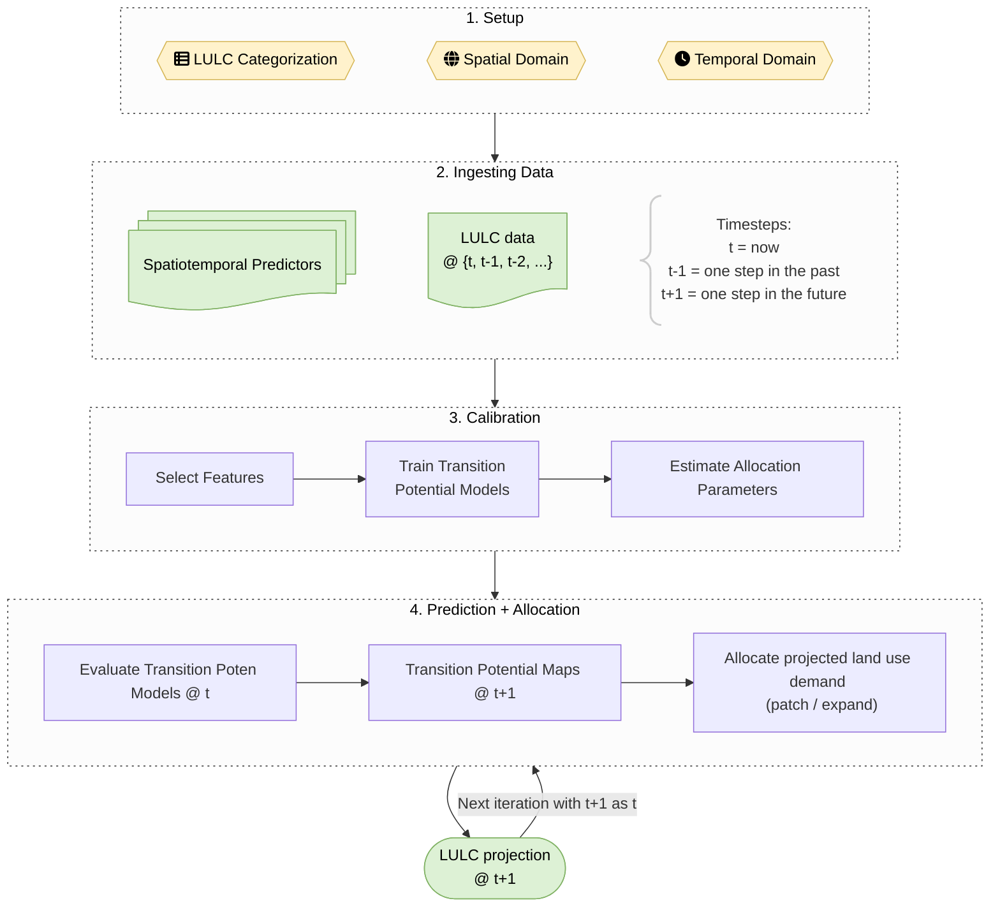
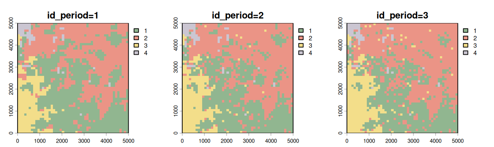
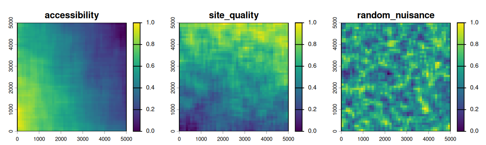
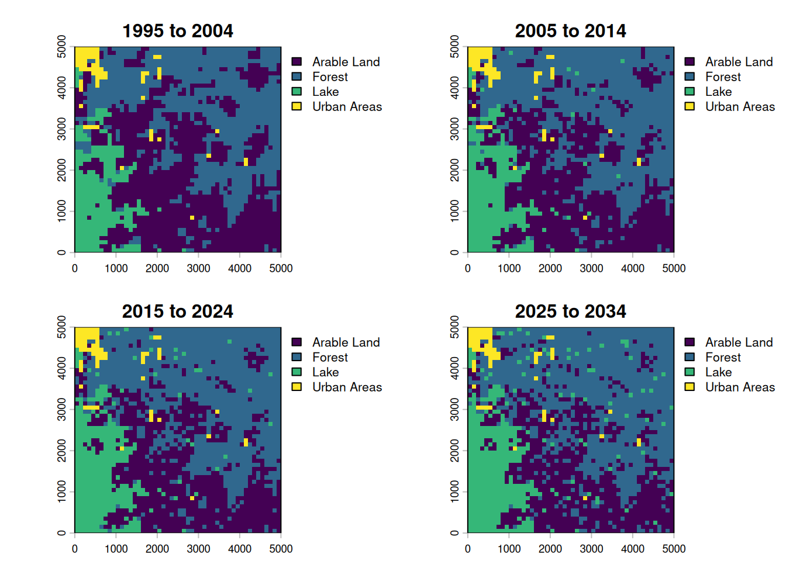
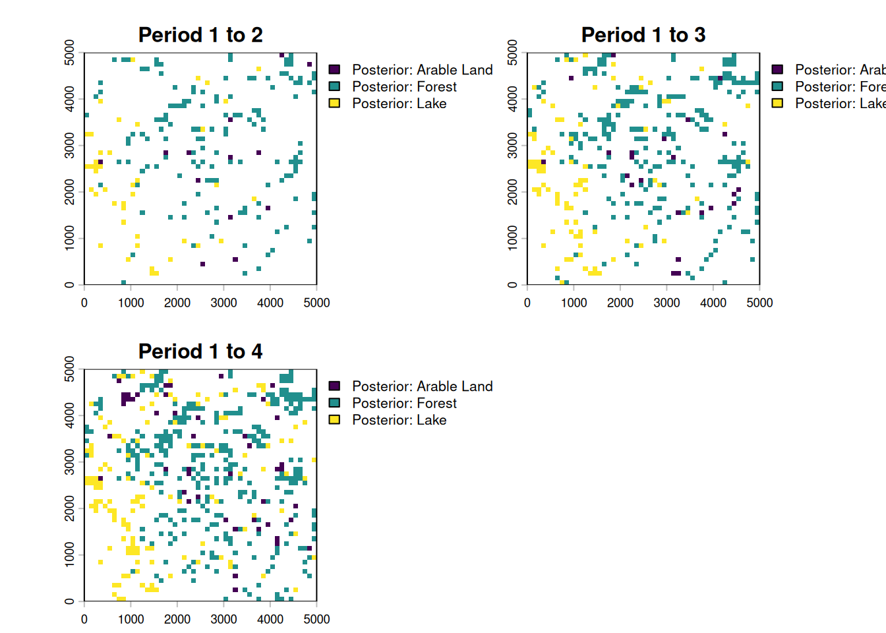

# `evoland.plus` tutorial

*Note: This tutorial expects that you already know about geodata and
some central principles of pattern-based land use change modelling.*

This file introduces the `evoland.plus` R package, or `evoland.plus` for
short. `evoland.plus` builds on the idea that land use change can be
predicted from observed change patterns. The likelihood that a location
and its neighbors will change state is called *transition potential* and
is estimated per location. A concrete realization of all possible
transitions (e.g. forest-\>grass, grass-\>forest, etc.) is realized in
an *allocation* across all locations and classes. Because the transition
potential is spatially and temporally autocorrelated, an extrapolation
must be autoregressive.

## Workflow



## 1 Setup

We’ll use the following packages:

``` r

library(evoland.plus)
library(data.table)
library(terra)
```

### 1.1 Creating an `evoland.plus` database

First, we load the package and create an `evoland_db` database object:
unlike most R objects (e.g. `data.frame`), this is a mutable object[^1],
meaning we can alter its state like we would with a Python object. This
nicely mirrors our persistent database on disk.

If there is no directory at `path`, we’ll create a new DB: a
self-contained folder holding a catalog and its data files, with clearly
defined tables. If there *is* a directory, we resume from where we left
off.

``` r

db <- evoland_db$new(path = "firstmodel.evolanddb")
```

Go ahead and print the `db` object. There are already a `runs_t` and a
`reporting_t` table, which are bare-bones for now but will be used to
track our [modelling
runs](https://ethzplus.github.io/evoland.plus/reference/runs_t.md) and
metadata for producing graphs and tables.

``` r

db
```

    <evoland_db> Object. Inherits from <ducklake_db>
     | Catalog: sqlite:firstmodel.evolanddb/catalog.sqlite
     | Data Path: firstmodel.evolanddb/data/
     | Read Only: FALSE
     | Active Run: 0
     | Lineage: 0

    Tables Present:
      reporting_t, runs_t

    DB Methods:
      checkpoint, commit, delete_from, execute, fetch, get_query, get_read_expr,
      get_table_metadata, list_tables, next_id, row_count, transaction

    Public Methods:
      add_predictor, adjusted_trans_pot_v, create_alloc_params_t, figure_of_merit_v,
      fit_full_models, fit_partial_models, generate_neighbor_predictors,
      get_crossval_plots, get_obs_trans_rates, get_pred_filter_score,
      lulc_crosstab_v, lulc_data_as_rast, pred_wide_predict_v, pred_wide_train_v,
      predict_trans_pot, set_full_trans_preds, set_neighbors, set_report,
      upsert_new_neighbors

    Active Bindings:
      coords_minimal, extent, id_run, lulc_meta_long_v, pred_sources_v, run_lineage,
      trans_v

### 1.2 Defining our model framework

Before we do anything else, let’s declare the framework of our model:

- **Land Use / Cover Categories**: A set of *land use and/or land cover
  classes* between which changes can occur
- **Spatial Domain**: A set of *coordinates*, built from a geographic
  specification
- **Temporal Domain**: A set of *periods*, describing a regular time
  series

#### 1.2.1 LULC Categories

We define our fundamental LULC classes. The `src_classes` field maps the
underlying data source’s classes to our conceptual categories. Real data
sources usually have many more classes than a model needs, so several
source classes are typically aggregated into one model class; the
synthetic data we use below already come with our four classes.

``` r

db$lulc_meta_t <- create_lulc_meta_t(
  list(
    forest = list(
      pretty_name = "Forest",
      description = "Areas with lots of trees",
      src_classes = 1
    ),
    arable = list(
      pretty_name = "Arable Land",
      src_classes = 2
    ),
    urban = list(
      pretty_name = "Urban Areas",
      description = "Where nature goes to die",
      src_classes = 3
    ),
    static = list(
      pretty_name = "Lake",
      description = "Static land use class (except if you're Dutch)",
      src_classes = 4
    )
  )
)
```

#### 1.2.2 Spatial domain

The spatial coordinate points provide the fundamental geographic domain
on which our model will operate. We use a dense square raster, but since
we register individual coordinate points, we could subset these to any
oddly shaped region of interest.

For this tutorial, we do not read real observed data. Instead,
[`synthetic_landscape()`](https://ethzplus.github.io/evoland.plus/reference/synthetic_landscape.md)
simulates a 50 x 50 cell landscape at the origin of Web Mercator
coordinates (EPSG:3857), together with the drivers of its change, over
three periods. Its grid defines our spatial domain.

``` r

landscape <- synthetic_landscape(n_periods = 3, n_cells = 50)

db$coords_t <- create_coords_t_square(
  epsg = 3857L,
  extent = terra::ext(landscape$lulc),
  resolution = terra::res(landscape$lulc)[1]
)
```

You can retrieve coords_t from disk and filter using [`data.table`
semantics](https://raw.githubusercontent.com/rstudio/cheatsheets/master/datatable.pdf):

``` r

db$coords_t[lon == 2950]
```

    Coordinate Table
    longitude (x) range: [2950, 2950]
    latitude  (y) range: [50, 4950]
    Key: <id_coord>
        id_coord   lon   lat
           <int> <num> <num>
     1:       30  2950  4950
     2:       80  2950  4850
     3:      130  2950  4750
     4:      180  2950  4650
     5:      230  2950  4550
    ---
    46:     2280  2950   450
    47:     2330  2950   350
    48:     2380  2950   250
    49:     2430  2950   150
    50:     2480  2950    50

We can also retrieve a minimal representation (id, lat, lon) using an
active binding, i.e. a method tied to the database that dynamically
computes a property when called:

``` r

db$coords_minimal[1:2]
```

    Key: <id_coord>
       id_coord   lon   lat
          <int> <num> <num>
    1:        1    50  4950
    2:        2   150  4950

#### 1.2.3 Temporal domain

We also define our temporal domain. Note that an additional “0th” period
is added at the end of the observed range; this is used for labelling
predictor data as static.

``` r

db$periods_t <- create_periods_t(
  period_length_str = "P10Y", # 10 year period
  start_observed = "1995-01-01",
  end_observed = "2020-01-01",
  end_extrapolated = "2030-01-01"
)
```

## 2 Ingesting Data

### 2.1 LULC Data

The synthetic landscape changes through a known process, so that the
model has a signal to learn: urban land grows next to existing urban
land where accessibility is high, forest turns into arable land on good
sites next to arable land, and arable land returns to forest on poor,
remote sites next to forest.
[`?synthetic_landscape`](https://ethzplus.github.io/evoland.plus/reference/synthetic_landscape.md)
states the process exactly; the model below does not get to see it, only
the maps and the drivers.

``` r

lulc_colors <- data.frame(value = 1:4, color = c("#91B690", "#EB9486", "#F3DE8A", "#CBC6D2"))
plot(landscape$lulc, nc = 3, col = lulc_colors)
```



We now extract the generated values at our coordinates using
`extract_using_coords_t`, giving us a tabular representation of
`id_coord, id_period, src_class` tuples. In a second step, we join in a
long representation of the LULC metadata, associating `id_lulc` with
`src_class`.

``` r

synthetic_at_coords <- extract_using_coords_t(landscape$lulc, db$coords_t)

synthetic_joint_meta <-
  synthetic_at_coords[, .(
    id_coord,
    id_period = sub(".*[^0-9]", "", layer) |> as.integer(), # "id_period=1" -> 1
    src_class = value
  )][
    db$lulc_meta_long_v, # map from id_lulc to src_class
    on = .(src_class),
    nomatch = NULL
  ]
```

We now have the LULC data in an almost canonical format. We need to add
information on which `id_run` this data belongs to: run 0 is the base
run, providing observed data (see
[`db$runs_t`](https://ethzplus.github.io/evoland.plus/reference/runs_t.md)
for details). The call to
[`as_lulc_data_t`](https://ethzplus.github.io/evoland.plus/reference/lulc_data_t.md)
ensures that the data we want to insert actually conforms to the form we
are expecting.

``` r

db$lulc_data_t <- as_lulc_data_t(synthetic_joint_meta[, .(
  id_run = 0L, # Base run ID
  id_period,
  id_lulc,
  id_coord
)])
```

Now that we have LULC data in our DB, we can derive data from it,
e.g. we grab a view where a transition occurred, i.e. the anterior and
posterior LULC ID are not the same.

``` r

db$trans_v[id_lulc_anterior != id_lulc_posterior]
```

         id_period id_lulc_anterior id_lulc_posterior id_coord
             <int>            <int>             <int>    <int>
      1:         3                1                 2        9
      2:         3                2                 3       13
      3:         3                1                 2       17
      4:         3                1                 2       18
      5:         3                2                 1       19
     ---
    372:         3                1                 2     2407
    373:         3                1                 2     2436
    374:         3                1                 3     2458
    375:         2                1                 2     2459
    376:         3                1                 2     2493

### 2.2 Add Predictors and Neighbors

You have seen above how
[`extract_using_coords_t`](https://ethzplus.github.io/evoland.plus/reference/util_terra.md)
can be used to transform a `SpatRaster` into a tabular form. It can also
be used with `SpatVector` objects, and the resulting tables need not
just be LULC data: we use it to extract the drivers of the synthetic
landscape as predictors. Two of them, `accessibility` and
`site_quality`, drive the change; `random_nuisance` does not, and a good
model should learn to ignore it.

The drivers do not change over time, so we store them under the static
period `0`. `db$add_predictor()` registers each predictor’s metadata and
data in one go. The metadata holds a `fill_value` used to define what
value should be used at a coordinate point with no explicit data set -
e.g. if a square kilometre does not have a population count set, we can
infer that it should be zero.

``` r

plot(landscape$drivers, nc = 3)
```



``` r

drivers_at_coords <- extract_using_coords_t(landscape$drivers, db$coords_t)
for (driver in names(landscape$drivers)) {
  db$add_predictor(
    pred_data_raw = drivers_at_coords[layer == driver, .(id_coord, id_period = 0L, value)],
    name = driver,
    fill_value = 0,
    description = "Driver of the synthetic landscape, see ?synthetic_landscape"
  )
}
```

Statistical models like GLMs or random forests lack inherent spatial
concepts, so we explicitly calculate neighborhood relations for each
coordinate to create spatial predictors (e.g., “number of neighboring
forest cells within 100m”). This is done by creating a neighbor lookup
table
([`db$set_neighbors`](https://ethzplus.github.io/evoland.plus/reference/neighbors_t.md)
and then counting the number of neighbors within each distance break
class and land use category (`db$generate_neighbor_predictors`).

``` r

db$set_neighbors(
  max_distance = 1000,
  distance_breaks = c(0, 300, 1000),
  quiet = TRUE
)
```

``` r

db$generate_neighbor_predictors()
```

Messages

    Computed 659800 neighbor relationships in 1 chunk(s)
    Appended 8 neighbor predictor variables with 42724 data points

Have a look at the predictor metadata we have defined, it now contains
new rows for the neighbor predictors:

``` r

db$pred_meta_t
```

    Predictor Metadata Table
    Number of predictors: 11
    Key: <name>
        id_pred                       name
          <int>                     <char>
     1:       1              accessibility
     2:       9     id_lulc_1_dist_[0,300)
     3:       5 id_lulc_1_dist_[300,1e+03]
     4:       8     id_lulc_2_dist_[0,300)
     5:       4 id_lulc_2_dist_[300,1e+03]
     6:      11     id_lulc_3_dist_[0,300)
     7:       7 id_lulc_3_dist_[300,1e+03]
     8:      10     id_lulc_4_dist_[0,300)
     9:       6 id_lulc_4_dist_[300,1e+03]
    10:       3            random_nuisance
    11:       2               site_quality
    8 variables not shown: [pretty_name <char>, description <char>, orig_format <char>, sources <list>, unit <char>, factor_levels <list>, data_type <fctr>, fill_value <char>]

## 3 Calibration

For consistency across different model packages, `evoland.plus` uses the
[`mlr3`](https://mlr-org.com/) machine learning and statistics
environment. For a hands-on introduction, see [mlr3 by
Example](https://mlr3book.mlr-org.com/chapters/chapter1/introduction_and_overview.html#mlr3-by-example).

### 3.1 Eligible Transitions and Predictor Pruning

We filter transitions eligible for modeling based on a minimum number of
observed occurrences, and exclude the lake, which cannot change.

``` r

db$trans_meta_t <- create_trans_meta_t(
  db$trans_v,
  min_cardinality_abs = 20,
  exclude_anterior = 4 # the lake
)
db$trans_meta_t
```

    Transition Metadata Table
    Total transition types: 4
    Viable for modelling: 4
    Total observed transitions: 376
    Key: <id_lulc_anterior, id_lulc_posterior>
       id_trans id_lulc_anterior id_lulc_posterior cardinality frequency_rel
          <int>            <int>             <int>       <int>         <num>
    1:        1                1                 2         254    0.67553191
    2:        2                1                 3          31    0.08244681
    3:        3                2                 1          35    0.09308511
    4:        4                2                 3          56    0.14893617
       frequency_abs is_viable
               <num>    <lgcl>
    1:        0.0508      TRUE
    2:        0.0062      TRUE
    3:        0.0070      TRUE
    4:        0.0112      TRUE

Because each transition may be modelled using different predictors (aka
*features*), we start out by setting the `trans_preds_t` table to the
full cross product of viable transitions and predictors. We then carry
out a feature selection step in `get_pred_filter_score`, which here is
used with a variable [importance
filter](https://mlr3filters.mlr-org.com/reference/mlr_filters_importance.html) -
an [mlr3 Learner](https://mlr3.mlr-org.com/reference/Learner.html) is
passed that returns an importance score for each predictor. We then set
`is_selected` from the score and assign the scored table back to
`db$trans_preds_t`. The assignment is an upsert: it updates the
`is_selected` fields and adds the score column to the DB table for
reporting purposes.

``` r

# set full crossproduct of transitions - predictors
db$set_full_trans_preds()
```

    [1] 44

``` r

# return importance scores for each predictor - transition combination
trans_pred_scored <- db$get_pred_filter_score(
  filter = mlr3filters::FilterImportance$new(
    learner = mlr3::lrn("classif.rpart")
  )
)
```

``` r

# deselect the low scorers; keep predictors that couldn't be scored
trans_pred_scored[, is_selected := importance > 5 | is.na(importance)]
db$trans_preds_t <- trans_pred_scored
```

Messages

    Processing 4 transitions...
    Added column(s) to `trans_preds_t`: importance (DOUBLE)

### 3.2 Transition Models

Now we fit partial models using training/validation splits, allowing for
a goodness-of-fit estimation using [mlr3
Measures](https://mlr3book.mlr-org.com/chapters/chapter2/data_and_basic_modeling.html#sec-eval).
We fit a first series of models using a featureless learner, i.e. only
estimating the response from the target variable (did a transition
occur?) probability distribution. We then fit an
[rpart](https://mlr3.mlr-org.com/reference/mlr_learners_classif.rpart.html)
recursive partitioning and regression learner. Next,
[`fit_full_models()`](https://ethzplus.github.io/evoland.plus/reference/trans_models_t.md)
reads the partial models stored in `db$trans_models_t`, chooses the best
model for each transition based on goodness of fit, and refits each
chosen model on all available predictor data. Assigning the result back
to db\$trans_models_t stores these full models for the extrapolation
step.

``` r

db$trans_models_t <- db$fit_partial_models(
  learner = mlr3::lrn("classif.featureless"),
  measures = c("classif.auc", "classif.acc"),
  sample_frac = 0.7,
  seed = 666
)
```

``` r

db$trans_models_t <- db$fit_partial_models(
  learner = mlr3::lrn("classif.rpart"),
  measures = c("classif.auc", "classif.acc"),
  sample_frac = 0.7,
  seed = 666
)
```

``` r

db$trans_models_t <- db$fit_full_models(
  select_score = "classif.auc",
  select_maximize = TRUE
)
```

Messages

    Fitting partial models for 4 transitions...
    Fitting partial models for 4 transitions...
    Fitting full models for 4 transitions...

### 3.3 Transition Rates and Allocation Parameters

As a constrained pattern-based model, we need to provide transition
rates to the DinamicaEGO allocator. In a simple approach, we can
extrapolate the rate of each transition from the observed data:

``` r

db$trans_rates_t <-
  db$get_obs_trans_rates() |>
  extrapolate_trans_rates(periods = db$periods_t)
```

We estimate allocation parameters, which determine the shape and size of
new patches, respectively which fraction of converted land use is in new
versus expanded patches. This estimation procedure is not unbiased and
hence a single estimate may not be enough: normally, we would perturb
the estimate, write each perturbed set onto an `id_run` of its own, and
identify the best parametrization. For simplicity, we now just take the
estimate for granted;
[`create_alloc_params_t()`](https://ethzplus.github.io/evoland.plus/reference/alloc_params_t.md)
returns it for the active run, here the base run `id_run=0`.

``` r

db$alloc_params_t <- db$create_alloc_params_t() # estimated for the active id_run 0
```

Messages

    Computing allocation parameters for 4 transitions across 2 periods...
      Processing period 1 -> 2
      Processing period 2 -> 3
    Aggregating parameters across periods...
    Computed allocation parameters for 4 transitions (id_run=0)

## 4 Prediction + Allocation

For this tutorial, we will use the CLUMPY backend for a self-contained
stochastic allocation that does not require the presence of
[DinamicaEGO](https://ethzplus.github.io/evoland.plus/articles/install-dinamica.md)
as an external solver.

``` r

allocate(
  db,
  id_periods = db$periods_t[is_extrapolated == TRUE, id_period], # all extrapolation periods
  allocator = alloc_clumpy_spec(),
  select_score = "classif.auc",
  select_maximize = TRUE
)
```

Messages

    Allocating with CLUMPY: run 0, periods 4
    Predicting transition potential for 4 transitions
    Predicting transition 1/4 (id_trans=1)
    Predicting transition 2/4 (id_trans=2)
    Predicting transition 3/4 (id_trans=3)
    Predicting transition 4/4 (id_trans=4)
      CLUMPY: period 3 -> 4
      CLUMPY method: uPAM
      Changed 169 of 2500 cells

### 4.1 Visualization

Finally, we can extract the simulated LULC maps into `SpatRaster`
objects to visualize them.

``` r

labels <- db$periods_t[
  id_period != 0,
  paste0(year(start_date), " to ", year(end_date))
]
plot_maps <-
  db$lulc_data_as_rast() |>
  categories(
    layer = 0, # set for all layers
    value = data.frame(id = 1:4, name = db$lulc_meta_t$pretty_name)
  ) |>
  setNames(labels)

plot(plot_maps)
```



Due to the extrapolated transition rates, the last step shows a similar
difference as exists between the first three periods. We can also show
the cumulative difference like so:

``` r

changes <-
  c(
    ifel(plot_maps[[1]] != plot_maps[[2]], plot_maps[[2]], NA),
    ifel(plot_maps[[1]] != plot_maps[[3]], plot_maps[[3]], NA),
    ifel(plot_maps[[1]] != plot_maps[[4]], plot_maps[[4]], NA)
  ) |>
  categories(
    layer = 0,
    value = data.frame(id = 1:4, name = paste("Posterior:", db$lulc_meta_t$pretty_name))
  ) |>
  setNames(paste("Period 1 to", 2:4))

plot(changes)
```



[^1]: Specifically, we’re creating an R6 object instead of an S3 or S4
    one. This is called “encapsulated object oriented programming”
    (cf. [Advanced R](https://adv-r.hadley.nz/r6.html)) and you might
    know it from Python (e.g. `pandas_df.drop_duplicates()`).
